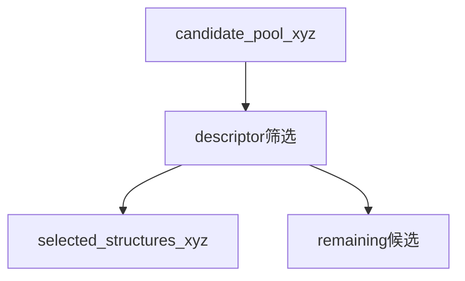

# DCBF Reduce：reference_guided

## 适用场景

以已有训练集为参考，从候选池补充描述符空间中缺失或低覆盖的结构，只执行一次筛选。

`user_sus2/` 使用用户提供的完整 `.sus2`，例如 `../../models/static.sus2`；`universal_sus2_87/` 使用包内 87 元素模型 `builtin:sus2_87`。两者的 Reduce 字段和输出语义完全相同。

## 参数

```json
"reduce": {
  "selection_mode": "reference_guided",
  "candidate_pool_xyz": "./pool.xyz",
  "reference_training_xyz": "./seed.xyz",
  "starting_model_path": "./specialized.sus2",
  "selected_structures_xyz": "candidate_pool_selected_structures.xyz",
  "remaining_candidates_xyz": "candidate_pool_remaining_candidates.xyz",
  "update_model_after_selection": false,
  "run_scf_labeling": false
}
```

`candidate_pool_xyz` 是待筛选池；`reference_training_xyz` 是已有训练集，`candidate_only` 可省略或填 `null`；`starting_model_path` 是本次描述符筛选实际使用的完整模型。`selected_structures_xyz` 只保存本次接纳结构，`remaining_candidates_xyz` 保存最后仍未接纳的候选结构。

`selection_budget_by_coverage` 和 `coverage_target_by_stage` 是一次性 Reduce 的可选字段：两者都省略时不进行任何预算或阈值截断，输出全部去冗余/min-cover 结果。若保留旧的 `selection_budget_by_coverage`，只取第一个阶段预算做兼容截断，截断前按 min-cover 贡献（结构覆盖的未覆盖环境类数）降序排序，不按帧号或随机顺序。`max_total_new_structures` 已废弃，出现时打印一次警告并忽略；`max_new_labels` 仍会被拒绝。标量阈值会广播到元素，二维数组按运行时元素顺序逐元素使用。

模型更新所需配置放在同一 JSON 的 `potential.model_yaml`、`training.sampling.subsequent_iterations` 和 `scheduler.train`；SCF 配置放在 `dft` 与 `scheduler.scf`。旧字段 `mode/input_xyz/current_xyz/model_path/output_xyz/remain_xyz/max_new_labels/update_model/run_scf` 会直接报迁移错误。

`potential.model_yaml` 仅在 `update_model_after_selection: true` 时需要；一次性选样和仅 SCF 可省略。

## 文件与恢复

每轮写入 `work_dir/updates/round_0001/`：`pool_before.xyz`、`selected_before_labeling.xyz`、`labeled_after_scf.xyz`、`pool_after.xyz`、`model_before.sus2`、`model_after.sus2`、`continuation.yaml`、`selection_report.json`、`scf_report.json` 和 `round_state.json`。checkpoint 在 `reduce_update_checkpoint.json`。在筛选、SCF、合并或训练中断后重新执行同一配置，已完成阶段通过哈希和阶段状态复用，不重复成功的作业或入库结构。

## 流程



## 最小示例

```bash
source "$DCBF_HOME/activate.sh"
dcbf reduce example/reduce/user_sus2/dcbf.reduce.dcbf.reduce.reference_guided.example.json.json
```

## 假设的多轮案例

一次性 Reduce 从 `pool.xyz` 输出全部去冗余/min-cover 结果；若显式保留了 `selection_budget_by_coverage`，只按第一个阶段预算截断，并优先保留覆盖未覆盖环境类最多的结构。selected 与 remaining 始终是精确补集，reference 帧不会重复写入 selected。
