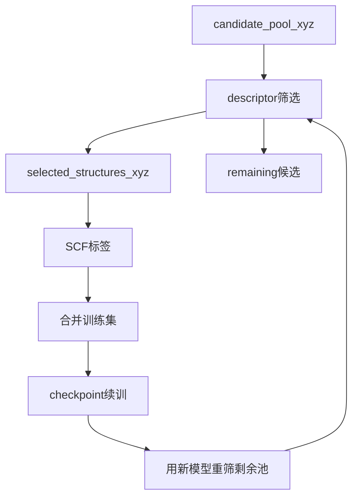

# DCBF Reduce：update_model_scf

## 适用场景

完整的 Reduce → SCF → 合并标签 → SUS2 续训 → 用新模型重新筛选剩余池循环。

`user_sus2/` 使用用户提供的完整 `.sus2`，例如 `../../models/static.sus2`；`universal_sus2_87/` 使用包内 87 元素模型 `builtin:sus2_87`。两者的 Reduce 字段和输出语义完全相同。

## 参数

```json
"reduce": {
  "selection_mode": "reference_guided",
  "candidate_pool_xyz": "./pool.xyz",
  "reference_training_xyz": "./seed.xyz",
  "starting_model_path": "./specialized.sus2",
  "selected_structures_xyz": "candidate_pool_selected_structures.xyz",
  "remaining_candidates_xyz": "candidate_pool_remaining_candidates.xyz",
  "selection_budget_by_coverage": [5000, 3000, 2000],
  "coverage_target_by_stage": [99.5, 99.9, 99.92],
  "max_update_rounds": 3,
  "update_model_after_selection": true,
  "run_scf_labeling": true
}
```

`candidate_pool_xyz` 是待筛选池；`reference_training_xyz` 是已有训练集，`candidate_only` 可省略或填 `null`；`starting_model_path` 是本次描述符筛选实际使用的完整模型。`selected_structures_xyz` 只保存本次接纳结构，`remaining_candidates_xyz` 保存最后仍未接纳的候选结构。

`selection_budget_by_coverage` 和 `coverage_target_by_stage` 在多轮 update/SCF 中必填并按阶段配对。标量阈值会广播到元素，二维数组按运行时元素顺序逐元素使用；预算是结构数，`calc_dir_num` 只是 SCF 任务分组数。每轮开始时按当前训练集对剩余候选池的逐元素覆盖率选择第一个尚未达标阶段的预算，达到最终阈值即以 `coverage_target_reached` 停止；`max_update_rounds` 仅是安全上限（`max_update_rounds_reached`）。选样先按 min-cover 贡献降序排序，再按阶段预算截断。`max_total_new_structures` 已废弃，出现时打印一次警告并忽略；`max_new_labels` 仍会被拒绝。

模型更新所需配置放在同一 JSON 的 `potential.model_yaml`、`training.sampling.subsequent_iterations` 和 `scheduler.train`；SCF 配置放在 `dft` 与 `scheduler.scf`。旧字段 `mode/input_xyz/current_xyz/model_path/output_xyz/remain_xyz/max_new_labels/update_model/run_scf` 会直接报迁移错误。

## 文件与恢复

每轮写入 `work_dir/updates/round_0001/`：`pool_before.xyz`、`selected_before_labeling.xyz`、`labeled_after_scf.xyz`、`pool_after.xyz`、`model_before.sus2`、`model_after.sus2`、`continuation.yaml`、`selection_report.json`、`scf_report.json` 和 `round_state.json`。checkpoint 在 `reduce_update_checkpoint.json`。在筛选、SCF、合并或训练中断后重新执行同一配置，已完成阶段通过哈希和阶段状态复用，不重复成功的作业或入库结构。

## 流程



## 最小示例

```bash
source "$DCBF_HOME/activate.sh"
dcbf reduce example/reduce/user_sus2/dcbf.reduce.dcbf.reduce.update_model_scf.json.json
```

## 假设的多轮案例

第一轮按当前覆盖率所在阶段的预算筛选（update_model 默认 12/8/5，SCF 默认 5000/3000/2000），成功标签并入 `reference_training_xyz`；后续轮次根据新的覆盖率自动进入下一阶段。达到最终覆盖率目标、候选为空、当前轮无新增结构或达到 `max_update_rounds` 安全上限时停止。所有轮次目录永久保留，可逐帧复核。
